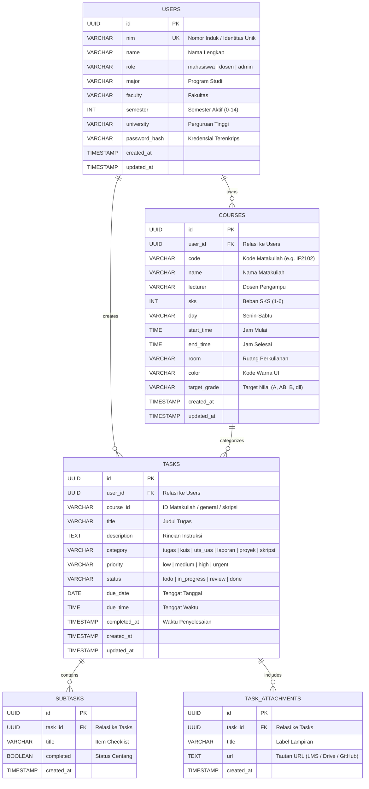

# Desain Basis Data & ERD — StudyFlow

Dokumen ini mendokumentasikan skema relasional, diagram hubungan entitas (ERD), aturan integritas, strategi indexing, serta mekanisme migrasi database PostgreSQL pada sistem **StudyFlow**.

---

## 1. Diagram Relasi Entitas (Entity-Relationship Diagram)



---

## 2. Rincian Kamus Data (Data Dictionary)

### Tabel: `users`
Menyimpan data identitas akun pengguna (Mahasiswa, Dosen, Admin).
| Kolom | Tipe Data | Constraint | Deskripsi |
| :--- | :--- | :--- | :--- |
| `id` | UUID | PRIMARY KEY, DEFAULT uuid_generate_v4() | Identifier unik akun |
| `nim` | VARCHAR(32) | NOT NULL, UNIQUE | NIM mahasiswa / NIP dosen / ID admin |
| `name` | VARCHAR(255) | NOT NULL | Nama lengkap |
| `role` | VARCHAR(32) | NOT NULL, DEFAULT 'mahasiswa' | Role akun (`mahasiswa`, `dosen`, `admin`) |
| `major` | VARCHAR(255) | NOT NULL | Program studi / unit kerja |
| `faculty` | VARCHAR(255) | NOT NULL | Fakultas / biro akademik |
| `semester` | INT | NOT NULL, DEFAULT 1, CHECK (0-14) | Semester aktif perkuliahan |
| `university`| VARCHAR(255) | NOT NULL | Nama perguruan tinggi |
| `password_hash` | VARCHAR(255) | NOT NULL | Hash kredensial sandi pengguna |
| `created_at`| TIMESTAMPTZ | DEFAULT CURRENT_TIMESTAMP | Waktu pembuatan akun |

---

### Tabel: `courses`
Menyimpan jadwal mata kuliah mingguan, dosen pengampu, ruang kelas, dan target nilai.
| Kolom | Tipe Data | Constraint | Deskripsi |
| :--- | :--- | :--- | :--- |
| `id` | UUID | PRIMARY KEY | Identifier unik mata kuliah |
| `user_id` | UUID | NOT NULL, FK users(id) ON DELETE CASCADE | Pemilik jadwal |
| `code` | VARCHAR(32) | NOT NULL | Kode mata kuliah (e.g. IF2102) |
| `name` | VARCHAR(255) | NOT NULL | Nama mata kuliah |
| `lecturer` | VARCHAR(255) | NOT NULL | Nama dosen pengampu |
| `sks` | INT | NOT NULL, CHECK (sks >= 1 AND sks <= 6) | Bobot SKS mata kuliah |
| `day` | VARCHAR(16) | NOT NULL, CHECK (Senin-Sabtu) | Hari jadwal perkuliahan |
| `start_time`| TIME | NOT NULL | Waktu mulai perkuliahan |
| `end_time` | TIME | NOT NULL | Waktu selesai perkuliahan |
| `room` | VARCHAR(128) | NOT NULL | Ruang kelas / laboratorium |
| `color` | VARCHAR(32) | DEFAULT 'blue' | Warna tema visual kartu |
| `target_grade` | VARCHAR(4) | CHECK (A, AB, B, BC, C, D, E) | Target nilai untuk simulasi IPS |

---

### Tabel: `tasks`
Menyimpan penugasan akademik, prioritas, siklus status, dan batas waktu pengumpulan.
| Kolom | Tipe Data | Constraint | Deskripsi |
| :--- | :--- | :--- | :--- |
| `id` | UUID | PRIMARY KEY | Identifier unik tugas |
| `user_id` | UUID | NOT NULL, FK users(id) ON DELETE CASCADE | Pemilik tugas |
| `course_id` | VARCHAR(64) | DEFAULT 'general' | Relasi ke mata kuliah |
| `title` | VARCHAR(255) | NOT NULL | Judul tugas perkuliahan |
| `description`| TEXT | NULLABLE | Rincian atau instruksi tugas |
| `category` | VARCHAR(32) | CHECK (tugas, kuis, uts_uas, laporan, proyek, skripsi, lainnya) | Kategori penugasan |
| `priority` | VARCHAR(16) | CHECK (low, medium, high, urgent) | Tingkat prioritas urgensi |
| `status` | VARCHAR(16) | CHECK (todo, in_progress, review, done) | Status siklus hidup pengerjaan |
| `due_date` | DATE | NOT NULL | Tanggal tenggat pengumpulan |
| `due_time` | TIME | DEFAULT '23:59' | Jam batas akhir pengumpulan |
| `completed_at` | TIMESTAMPTZ | NULLABLE | Waktu penyelesaian tugas |

---

## 3. Strategi Indeks (B-Tree Performance Indexing)

Untuk memastikan waktu respon query tetap di bawah 10 milidetik saat volume data membesar:

```sql
-- Mempercepat proses otentikasi login
CREATE INDEX IF NOT EXISTS idx_users_nim ON users(nim);

-- Mempercepat query timetable mingguan per pengguna
CREATE INDEX IF NOT EXISTS idx_courses_user_id ON courses(user_id);
CREATE INDEX IF NOT EXISTS idx_courses_day ON courses(day);

-- Mempercepat filter Kanban, status, prioritas, dan countdown deadline
CREATE INDEX IF NOT EXISTS idx_tasks_user_id ON tasks(user_id);
CREATE INDEX IF NOT EXISTS idx_tasks_due_date ON tasks(due_date);
CREATE INDEX IF NOT EXISTS idx_tasks_status ON tasks(status);
CREATE INDEX IF NOT EXISTS idx_tasks_priority ON tasks(priority);

-- Mempercepat relasi checklist sub-tugas dan lampiran
CREATE INDEX IF NOT EXISTS idx_subtasks_task_id ON subtasks(task_id);
CREATE INDEX IF NOT EXISTS idx_task_attachments_task_id ON task_attachments(task_id);
```

---

## 4. Mekanisme Migrasi Skema Basis Data

Migrasi dikelola secara berurutan dalam folder [database/migrations/](file:///s:/gabut/jajal/database/migrations):
- `001_initial_schema.sql`: Pembuatan skema dasar, ekstensi UUID, tabel entitas awal, dan tabel audit migrasi `schema_migrations`.
- `002_add_user_roles.sql`: Penambahan kolom `role` pada tabel `users` dengan validasi nilai `mahasiswa`, `dosen`, dan `admin`.
