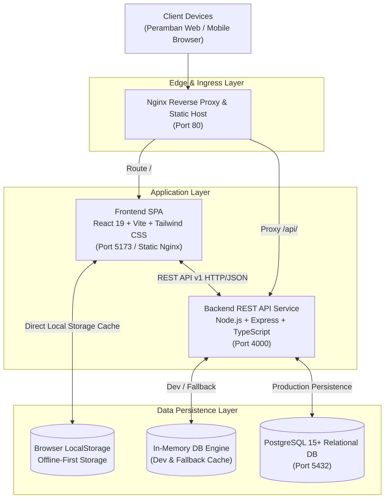
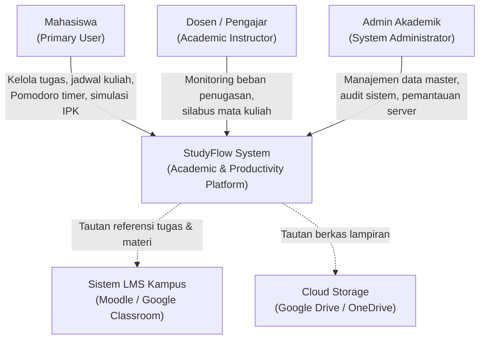
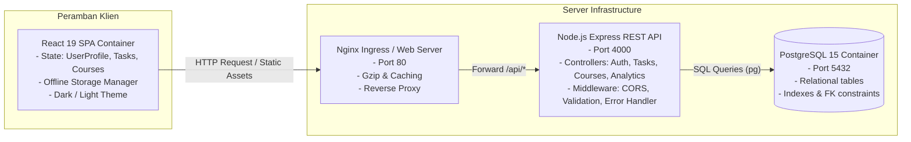
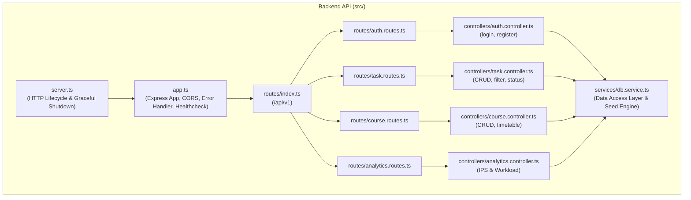
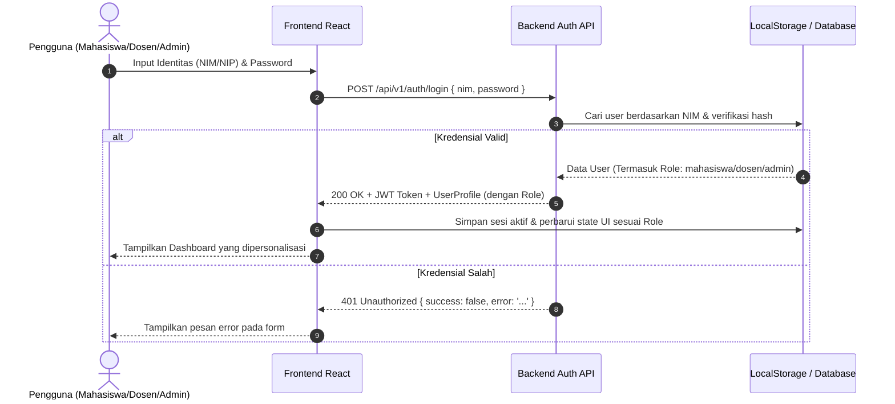
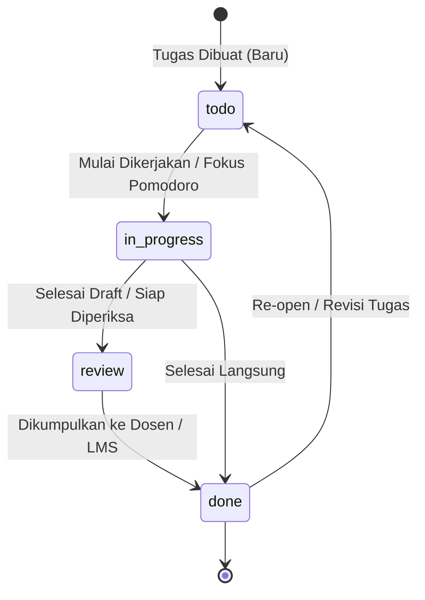
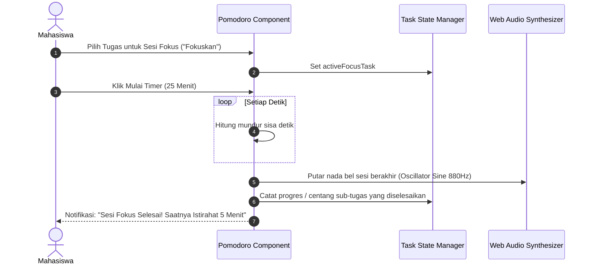

# Arsitektur Sistem — StudyFlow

Dokumen ini menjelaskan arsitektur teknis menyeluruh dari sistem **StudyFlow**, mencakup prinsip desain, diagram C4 (Context, Container, Component), diagram alur kerja, siklus hidup tugas, serta infrastruktur *deployment*.

---

## 1. Ikhtisar & Gaya Arsitektur

StudyFlow dirancang menggunakan pendekatan **Modular Monorepo** dan arsitektur **Offline-First Hybrid Client-Server**:



### Karakteristik Desain:
1. **Modular Monorepo:** Dikelola menggunakan NPM Workspaces (`frontend`, `backend`, `qa`) yang memungkinkan manajemen dependensi terpadu serta kompilasi independen.
2. **Offline-First Resilience:** Pengguna tetap dapat mengelola tugas, jadwal kuliah, dan timer belajar secara instan tanpa latensi jaringan memanfaatkan layer penyimpanan lokal peramban (`localStorage`). Data dapat disinkronkan ke backend REST API.
3. **Harmonisasi Desain & Palet Warna:**
   - **Plum / Royal Purple (`#5C3F6F`):** Warna primer (*brand primary*), header, tombol aksi utama, dan kartu dominan.
   - **Golden Yellow (`#F9D13C`):** Warna sekunder (*vibrant highlight*), badge urgensi, bintang prestasi, indikator aktif, dan aksen tombol.
   - **Warm White / Cream (`#FDF6EE`):** Warna aksen khusus (*accent color*), badge pill kontras, border lembut, teks kontras pada tombol gelap, serta efek cahaya latar.
4. **Layered Architecture:** Backend menerapkan pemisahan tanggung jawab yang ketat:
   - *Routes Layer:* Routing URL dan mapping HTTP method.
   - *Controllers Layer:* Validasi payload masukan dan serialisasi respons HTTP JSON.
   - *Services Layer:* Logika komputasi SKS, IPS, serta akses data.
5. **Containerized Multi-Stage:** Konfigurasi Docker multi-stage memastikan ukuran image produksi tetap ramping dan aman.

---

## 2. Model C4 — Visualisasi Sistem

### C4 Level 1: System Context Diagram



---

### C4 Level 2: Container Diagram



---

### C4 Level 3: Component Diagram (Backend API)



---

## 3. Alur Kerja Kunci Sistem (System Workflows)

### A. Alur Otentikasi & Otorisasi Pengguna



---

### B. Siklus Hidup Tugas (Task State Machine)



---

### C. Alur Sesi Pomodoro Terintegrasi Tugas



---

### D. Formula Kalkulasi Proyeksi IPS (Indeks Prestasi Semester)

Formula matematis penentuan nilai indeks prestasi semester berbobot SKS:

$$\text{IPS} = \frac{\sum_{i=1}^{n} (\text{SKS}_i \times \text{Bobot Nilai}_i)}{\sum_{i=1}^{n} \text{SKS}_i}$$

Tabel konversi standar nilai huruf ke angka bobot mutu:
| Nilai Huruf | Bobot Angka | Keterangan Mutu |
| :---: | :---: | :--- |
| **A** | 4.00 | Sangat Istimewa |
| **AB** | 3.50 | Istimewa |
| **B** | 3.00 | Sangat Baik |
| **BC** | 2.50 | Baik |
| **C** | 2.00 | Cukup |
| **D** | 1.00 | Kurang |
| **E** | 0.00 | Gagal |

---

## 4. Arsitektur Deployment & Kontainerisasi

```
                    ┌────────────────────────┐
                    │      Host Client       │
                    └───────────┬────────────┘
                                │ Port 80
                                ▼
         ┌───────────────────────────────────────────────┐
         │             Container: Frontend               │
         │   Nginx Alpine (Reverse Proxy & Static SPA)   │
         └───────┬───────────────────────────────┬───────┘
                 │ Proxy /api/*                  │ Serve /
                 │ Port 4000                     │ Static files
                 ▼                               ▼
    ┌─────────────────────────┐      ┌─────────────────────────┐
    │   Container: Backend    │      │    Assets (HTML/JS/CSS) │
    │ Node 22 Alpine Express  │      └─────────────────────────┘
    └────────────┬────────────┘
                 │ TCP 5432
                 ▼
    ┌─────────────────────────┐
    │   Container: Database   │
    │   PostgreSQL 15 Alpine  │
    └─────────────────────────┘
```
