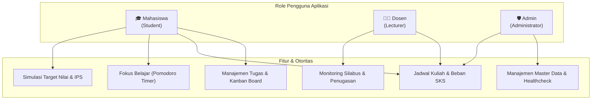

# Role Pengguna & Matriks Hak Akses (RBAC) — StudyFlow

Dokumen ini menguraikan setiap **Peran Pengguna Aplikasi (Application User Roles)** yang didukung oleh sistem StudyFlow beserta **Matriks Hak Akses (Role-Based Access Control / RBAC)** secara menyeluruh.

---

## 1. Ikhtisar Role Pengguna

StudyFlow memiliki 3 role pengguna terdaftar:

---

## 2. Rincian Peran & Kredensial Demo

### 🎓 Role 1: Mahasiswa (`mahasiswa`) — Primary User
- **Fungsi Utama:** Mengatur seluruh kegiatan akademik secara mandiri untuk meningkatkan keteraturan dan produktivitas belajar.
- **Kredensial Demo:**
  - **NIM:** `220101034`
  - **Kata Sandi:** `mahasiswa123`
  - **Profil:** Fajar Pratama (Teknik Informatika, Semester 5, Universitas Indonesia)
- **Fitur Khusus:**
  - Papan tugas **Kanban Board** & tampilan daftar (*List View*) dengan penyaringan status/prioritas.
  - Penambahan sub-tugas (*checklist items*) dan tautan referensi eksternal (LMS, Google Drive).
  - Jadwal kuliah mingguan (Senin–Sabtu) dengan pelacak akumulasi beban SKS semester aktif.
  - Sesi fokus belajar **Pomodoro Timer** (25 mnt kerja, 5 mnt istirahat) yang dapat ditautkan ke tugas spesifik.
  - Kalkulator simulasi **Indeks Prestasi Semester (IPS)** berdasarkan target nilai mata kuliah.
  - Fitur **Cadangkan & Pulihkan Data (JSON)** secara mandiri via LocalStorage.

---

### 👨‍🏫 Role 2: Dosen / Pengajar (`dosen`)
- **Fungsi Utama:** Mengelola jadwal perkuliahan mata kuliah yang diampu dan meninjau beban tugas yang diberikan kepada mahasiswa.
- **Kredensial Demo:**
  - **NIP / Identitas:** `198504122010121001`
  - **Kata Sandi:** `dosen123`
  - **Profil:** Dr. Aris Subagyo, M.Kom (Fakultas Ilmu Komputer, Universitas Indonesia)
- **Fitur Khusus:**
  - Tampilan profil ber-badge khusus **"Dosen"** berwarna hijau zamrud (*emerald*).
  - Monitoring jadwal mengajar, ruang kuliah, dan alokasi waktu perkuliahan.
  - Peninjauan distribusi beban penugasan akademik (tugas, kuis, laporan praktikum, proyek).

---

### 🛡️ Role 3: Administrator Akademik (`admin`)
- **Fungsi Utama:** Menjaga keandalan sistem, memantau kesehatan server, mengelola master data kurikulum, serta mengaudit integritas platform.
- **Kredensial Demo:**
  - **ID Admin:** `ADMIN001`
  - **Kata Sandi:** `admin123`
  - **Profil:** Administrator Akademik (Direktorat Akademik & SI)
- **Fitur Khusus:**
  - Tampilan profil ber-badge khusus **"Admin"** berwarna ungu (*violet*).
  - Pemantauan status operasional server melalui endpoint `/health`.
  - Verifikasi keutuhan skema basis data PostgreSQL dan riwayat migrasi terversi.
  - Penjaminan keunikan identitas NIM/NIP seluruh pengguna terdaftar.

---

## 3. Matriks Hak Akses (RBAC Matrix Table)

Tabel berikut menunjukkan hak akses operasi CRUD (*Create, Read, Update, Delete*) per modul untuk setiap role:

| Modul / Sumber Daya | Operasi | Mahasiswa (`mahasiswa`) | Dosen (`dosen`) | Admin (`admin`) |
| :--- | :---: | :---: | :---: | :---: |
| **Autentikasi Akun** | Register / Login | ✅ Akun Pribadi | ✅ Akun Pribadi | ✅ Hak Penuh |
| **Profil Pengguna** | Read / Update | ✅ Profil Sendiri | ✅ Profil Sendiri | ✅ Semua Pengguna |
| **Jadwal Kuliah (Courses)** | Create / Update / Delete | ✅ Jadwal Sendiri | ❌ Hanya Jadwal Ajar | ✅ Seluruh Matakuliah |
| **Tugas Kuliah (Tasks)** | Create / Read / Update | ✅ Tugas Sendiri | 👁️ Monitoring Agregat | ✅ Seluruh Data |
| **Checklist Sub-tugas** | Tambah / Centang Status | ✅ Bebas Akses | ❌ Tidak Ada | ✅ Seluruh Data |
| **Lampiran Tugas (Links)** | Tambah / Hapus Tautan | ✅ Bebas Akses | ❌ Tidak Ada | ✅ Seluruh Data |
| **Pomodoro Focus Timer** | Jalankan / Hubungkan Tugas | ✅ Bebas Akses | ❌ Tidak Ada | ❌ Tidak Ada |
| **Simulasi IPS / Nilai** | Input Target / Kalkulasi | ✅ Simulasi Pribadi | 👁️ Penilaian Mata Kuliah | ✅ Standar Skala Mutu |
| **Ekspor / Impor JSON** | Backup & Restore Data | ✅ Data Pribadi | ❌ Tidak Ada | ✅ Backup Database |
| **Healthcheck Server** | GET `/health` | ❌ Tidak Relevan | ❌ Tidak Relevan | ✅ Hak Penuh |
| **Migrasi Database** | Eksekusi DDL Skema | ❌ Dibatasi | ❌ Dibatasi | ✅ Hak Penuh |

> **Keterangan:**  
> ✅ = Diizinkan Penuh | ❌ = Tidak Diizinkan / Dibatasi | 👁️ = Izin Baca Terbatas (Read-Only)
