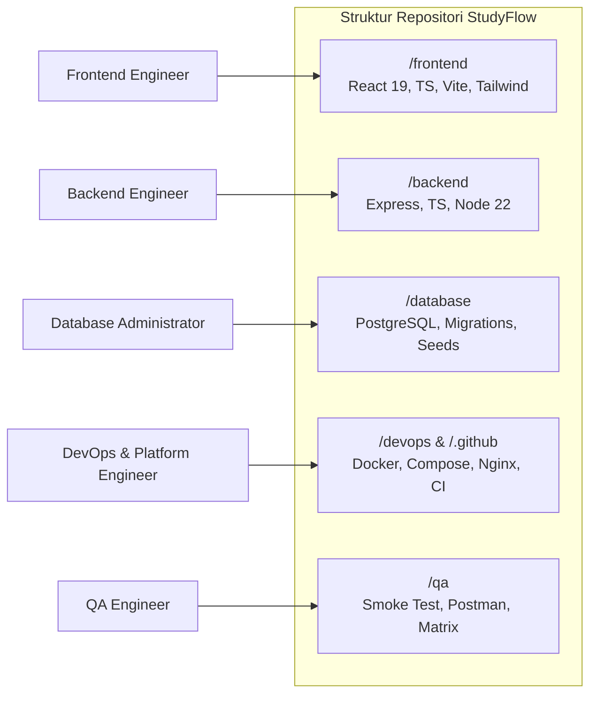

# Role Tim Rekayasa Perangkat Lunak (Monorepo) — StudyFlow

Dokumen ini mendokumentasikan spesialisasi peran teknis, pembagian direktori kerja, serta tanggung jawab masing-masing perekayasa perangkat lunak (*software engineers*) dalam ekosistem monorepo **StudyFlow**.

---

## 1. Pemetaan Ruang Lingkup Kerja

---

## 2. Spesifikasi Peran & Tanggung Jawab

### 1. Frontend Engineer
- **Area Tanggung Jawab:** [frontend/](file:///s:/gabut/jajal/frontend)
- **Teknologi Utama:** React 19, TypeScript 5.7, Vite 8, Tailwind CSS, Lucide React, Web Audio Synthesizer API.
- **Tugas & Tanggung Jawab:**
  1. Mengembangkan komponen antarmuka modular yang mudah dipelihara dan bebas *memory leak*.
  2. Mengimplementasikan arsitektur *offline-first* dengan sinkronisasi LocalStorage dan REST client API.
  3. Memastikan responsivitas tampilan pada berbagai ukuran layar (perangkat *mobile* 375px hingga desktop 1440px).
  4. Menjaga performa interaksi (smooth transition, kanban drag/click, efek suara timer, dan tema gelap).
  5. Menjalankan verifikasi kompilasi frontend melalui `npm run build:frontend`.

---

### 2. Backend Engineer
- **Area Tanggung Jawab:** [backend/](file:///s:/gabut/jajal/backend)
- **Teknologi Utama:** Node.js 22 LTS, Express.js 4, TypeScript 5.7, CORS, Dotenv.
- **Tugas & Tanggung Jawab:**
  1. Merancang dan mengembangkan endpoint RESTful API v1 terstandarisasi (`/auth`, `/tasks`, `/courses`, `/analytics`).
  2. Menerapkan pola *Layered Architecture* (Router $\rightarrow$ Controller $\rightarrow$ Service $\rightarrow$ Data Access).
  3. Menjaga konsistensi kontrak format respons (`ApiResponse<T>`) dan penanganan galat (*Global Error Handler*).
  4. Menjamin *graceful shutdown* proses server pada sinyal sistem operasi (`SIGINT`, `SIGTERM`).
  5. Menjalankan kompilasi TypeScript backend melalui `npm run build:backend`.

---

### 3. Database Administrator (DBA) / Data Engineer
- **Area Tanggung Jawab:** [database/](file:///s:/gabut/jajal/database)
- **Teknologi Utama:** PostgreSQL 15+, Relational SQL DDL, UUID-OSSP, B-Tree Indexing.
- **Tugas & Tanggung Jawab:**
  1. Merancang struktur normalisasi basis data relasional hingga bentuk ketiga (3NF).
  2. Menegakkan integritas referensial dan aksi berantai (`FOREIGN KEY ... ON DELETE CASCADE`).
  3. Menyusun skrip migrasi skema terversi (`database/migrations/`).
  4. Mengoptimalkan indeks pada kolom pencarian berkala (`user_id`, `nim`, `due_date`, `status`, `priority`).
  5. Menyiapkan dataset benih (*seed data*) pengujian awal yang representatif.

---

### 4. DevOps & Platform Engineer
- **Area Tanggung Jawab:** [devops/](file:///s:/gabut/jajal/devops), [.github/](file:///s:/gabut/jajal/.github)
- **Teknologi Utama:** Docker, Docker Compose, Nginx Alpine, GitHub Actions CI.
- **Tugas & Tanggung Jawab:**
  1. Menyusun Dockerfile multi-stage untuk kompilasi minimal dan efisien pada frontend dan backend.
  2. Mengonfigurasi Nginx sebagai *reverse proxy* dan *SPA static web server*.
  3. Mengelola konfigurasi variabel lingkungan yang aman melalui templat `.env.example`.
  4. Memelihara pipeline CI GitHub Actions untuk uji otomatis pada setiap *pull request*.

---

### 5. QA (Quality Assurance) & Test Automation Engineer
- **Area Tanggung Jawab:** [qa/](file:///s:/gabut/jajal/qa)
- **Teknologi Utama:** Node.js Native Test Runner (`node:test`, `node:assert/strict`), Postman API Collections.
- **Tugas & Tanggung Jawab:**
  1. Merancang dokumen rencana pengujian formal ([qa/test-plan.md](file:///s:/gabut/jajal/qa/test-plan.md)).
  2. Menulis dan menjalankan skrip *smoke test* otomatis ([qa/tests/api/smoke.test.ts](file:///s:/gabut/jajal/qa/tests/api/smoke.test.ts)).
  3. Memvalidasi batasan nilai, kalkulasi matematis IPS, integritas siklus status tugas, serta verifikasi RBAC.
  4. Menyiapkan koleksi pengujian endpoint REST di Postman untuk uji regresi manual maupun terotomasi.
